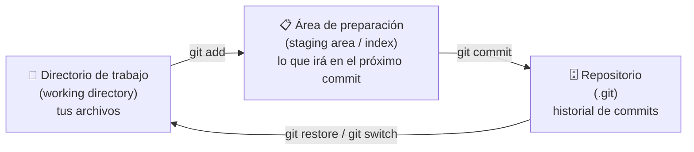
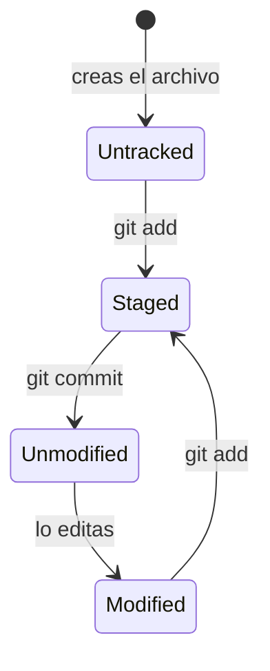

# Módulo 1 — Fundamentos de Git

⏱️ 60 minutos · [⬅️ Anterior](00-instalacion-configuracion.md) · [Índice](../README.md) · [Siguiente ➡️](02-ramas-merge-conflictos.md)

## Objetivos

- Entender qué es un sistema de control de versiones.
- Conocer las **tres áreas** de Git.
- Crear un repositorio y hacer tus primeros commits.
- Ignorar archivos que no deben versionarse en un proyecto Java.

---

## 1. ¿Qué problema resuelve Git?

¿Te suena esto?

```
ProyectoPOO.zip
ProyectoPOO_final.zip
ProyectoPOO_final_AHORASI.zip
ProyectoPOO_final_AHORASI_v2_corregido.zip
```

Git reemplaza ese caos por un **historial** ordenado: cada versión (*commit*) tiene un autor, fecha, mensaje y un identificador único. Puedes volver a cualquier versión cuando quieras.

## 2. Las tres áreas de Git

Este es **el concepto más importante del curso**:



| Área | Qué es | Analogía |
|------|--------|----------|
| **Working directory** | Los archivos que editas en IntelliJ | Tu escritorio |
| **Staging area** | Cambios seleccionados para la próxima “foto” | La caja donde pones lo que vas a enviar |
| **Repositorio** | El historial guardado en la carpeta oculta `.git` | El archivo histórico, con cada caja sellada |

> 💡 ¿Por qué existe el staging? Porque te permite hacer commits **pequeños y temáticos**: si modificaste `Libro.java` y `Socio.java` por razones distintas, puedes hacer dos commits separados.

## 3. Estados de un archivo



## 4. Manos a la obra

### 4.1 Crear un repositorio

```bash
mkdir biblioteca-poo
cd biblioteca-poo
git init
```

Esto crea la carpeta oculta `.git/`. **Nunca la borres ni la edites a mano**: ahí vive todo el historial.

### 4.2 Ver el estado — tu comando favorito

```bash
git status
```

Úsalo **antes y después de cada comando**. Te dice en qué rama estás, qué cambió y qué está en staging.

### 4.3 Primer commit

Crea `src/Libro.java`:

```java
public class Libro {
    private String titulo;
    private String autor;

    public Libro(String titulo, String autor) {
        this.titulo = titulo;
        this.autor = autor;
    }

    public String getTitulo() { return titulo; }
    public String getAutor()  { return autor; }
}
```

```bash
git status                  # Libro.java aparece como "Untracked"
git add src/Libro.java      # lo pasamos al staging
git status                  # ahora aparece en verde: "Changes to be committed"
git commit -m "Agrega clase Libro con titulo y autor"
```

Formas útiles de `git add`:

| Comando | Qué agrega |
|---------|-----------|
| `git add Archivo.java` | Un archivo |
| `git add src/` | Una carpeta completa |
| `git add .` | Todo lo modificado/nuevo desde la carpeta actual |
| `git add -p` | Te pregunta trozo por trozo (avanzado, muy útil) |

### 4.4 Ver el historial

```bash
git log                     # historial completo
git log --oneline           # una línea por commit
git log --oneline --graph --all   # con gráfico de ramas (lo usaremos mucho)
```

Ejemplo de salida:

```
a3f9c21 (HEAD -> main) Agrega clase Libro con titulo y autor
```

`a3f9c21` es el **hash** (identificador corto) del commit. `HEAD` indica “dónde estás parado”.

### 4.5 Ver diferencias

Modifica `Libro.java` agregando un atributo `isbn`. Luego:

```bash
git diff              # cambios en el working directory que AÚN NO están en staging
git add src/Libro.java
git diff --staged     # cambios que SÍ están en staging (irán en el próximo commit)
git commit -m "Agrega atributo isbn a Libro"
```

### 4.6 Ver un commit específico

```bash
git show a3f9c21
```

## 5. `.gitignore`: lo que NO se versiona

En un proyecto Java hay archivos que **nunca** deben subirse:

- Archivos compilados (`*.class`, carpetas `out/`, `target/`, `build/`).
- Configuración personal del IDE (`.idea/workspace.xml`).
- Archivos del sistema (`.DS_Store`, `Thumbs.db`).
- Contraseñas o credenciales (`.env`, `application-local.properties`).

Crea un archivo llamado `.gitignore` en la raíz del proyecto:

```gitignore
# Compilados
*.class
out/
target/
build/

# IntelliJ IDEA
.idea/workspace.xml
.idea/shelf/
*.iws

# Sistema operativo
.DS_Store
Thumbs.db

# Secretos
.env
```

```bash
git add .gitignore
git commit -m "Agrega .gitignore para proyecto Java"
```

👉 Hay una versión más completa en [`recursos/gitignore-java.txt`](../recursos/gitignore-java.txt).

> ⚠️ `.gitignore` solo afecta a archivos **no rastreados**. Si ya hiciste commit de `out/`, debes sacarlo del índice: `git rm -r --cached out/` y luego hacer commit.

## 6. ¿Qué es un buen commit?

- **Pequeño y con un solo propósito**: “Agrega clase Socio”, no “Avance”.
- **Compila**: no hagas commit de código roto en `main`.
- **Mensaje en imperativo**, como completando la frase *“Si aplico este commit, este commit…”*:
  - ✅ `Agrega método prestar() a Libro`
  - ✅ `Corrige NullPointerException al buscar socio`
  - ❌ `cambios`, `asdf`, `ahora si funciona`

Profundizamos en el [Módulo 6](06-deshacer-y-buenas-practicas.md).

## Resumen de comandos

| Comando | Para qué |
|---------|----------|
| `git init` | Crea un repositorio |
| `git status` | Muestra el estado actual |
| `git add <archivo>` | Mueve cambios al staging |
| `git commit -m "msg"` | Guarda una versión |
| `git log --oneline` | Historial resumido |
| `git diff` / `git diff --staged` | Muestra diferencias |
| `git show <hash>` | Detalle de un commit |

## ✅ Checkpoint

1. ¿Cuáles son las tres áreas de Git y qué comando mueve cambios entre ellas?
  Las 3 areas en mis palabras son: el directorio de trabajo (espacio donde hago cambios), el espacio donde comento que trabaje y el repositorio donde tengo mi proyecto (Las areas tienen otro nombre como tal, pero no manejo ese nivel de tecnisimo aun)

2. Si modificas un archivo y haces `git commit` sin `git add`, ¿qué ocurre?
  Lo que entiendo segun mi experiencia es que no se registran cambios que subir, en pocas palabras no puedes hacer un git commit sin contenido :)

3. ¿Por qué no se deben versionar los archivos `.class`?
  El archivo .class no lo manejo como tal, pero existen otros como .gitignore, .env e incluso la carpeta modules que en este ultimo caso se compila siempre en local (en mis palabras, es lo que entiendo), .env es para guardar claves ES INSEGURO SUBIR LAS CREDENCIALES, y el .gitignore son directamente el conjunto que le diremos a git que ignore al hacer commit.

PD: No son textualmente las mismas respuestas pero considero que van al mismo puerto...
<details>
<summary>Ver respuestas</summary>

1. Working directory → (`git add`) → staging → (`git commit`) → repositorio.
2. Git responde *“no changes added to commit”*: el cambio no está en staging, así que no se incluye.
3. Se generan automáticamente al compilar; versionarlos ensucia el historial y provoca conflictos inútiles.

</details>
