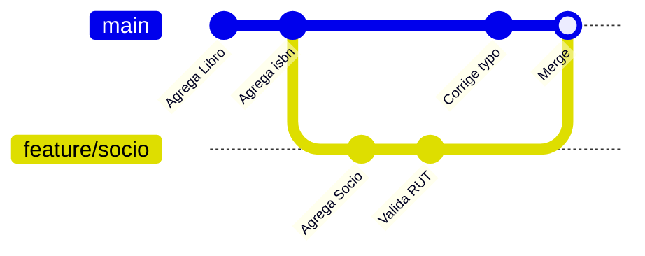
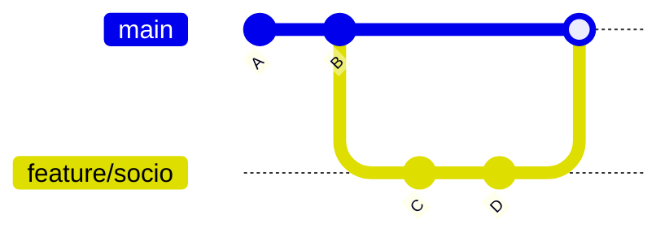

# Módulo 2 — Ramas, merge y conflictos

⏱️ 60 minutos · [⬅️ Anterior](01-fundamentos.md) · [Índice](../README.md) · [Siguiente ➡️](03-github-remotos.md)

## Objetivos

- Entender qué es una rama y para qué sirve.
- Crear, cambiar y eliminar ramas.
- Fusionar ramas con `merge`.
- Resolver un conflicto de merge sin entrar en pánico.

---

## 1. ¿Qué es una rama?

Una rama es una **línea de desarrollo independiente**. Técnicamente, es solo un puntero liviano a un commit.



¿Para qué sirven?

- Desarrollar una **funcionalidad nueva** (ej. clase `Prestamo`) sin romper lo que ya funciona en `main`.
- Que **cada integrante del equipo** trabaje en lo suyo en paralelo.
- **Experimentar**: si la idea no funciona, borras la rama y listo.

> 💡 Regla de oro: **`main` siempre debe compilar y funcionar.** Todo trabajo nuevo va en una rama.

## 2. Comandos básicos de ramas

```bash
git branch                       # lista ramas locales (* = rama actual)
git branch feature/socio         # crea una rama (pero NO te cambia a ella)
git switch feature/socio         # te cambia a esa rama
git switch -c feature/prestamo   # crea Y te cambia en un solo paso
git branch -d feature/socio      # elimina una rama ya fusionada
```

> ℹ️ En tutoriales antiguos verás `git checkout <rama>` y `git checkout -b <rama>`. Funcionan igual, pero `git switch` (Git ≥ 2.23) es más claro y es lo que usaremos.

### Convención de nombres de ramas

| Prefijo | Uso | Ejemplo |
|---------|-----|---------|
| `feature/` | Nueva funcionalidad | `feature/clase-prestamo` |
| `fix/` | Corrección de error | `fix/null-en-buscar-socio` |
| `docs/` | Documentación | `docs/readme-instalacion` |
| `refactor/` | Mejora interna sin cambiar comportamiento | `refactor/herencia-material` |

## 3. Trabajar en una rama

```bash
git switch -c feature/socio
# ... creas src/Socio.java en IntelliJ ...
git add src/Socio.java
git commit -m "Agrega clase Socio con rut y nombre"
git log --oneline --graph --all
```

Ahora vuelve a `main`:

```bash
git switch main
```

Mira tu carpeta `src/`: **¡`Socio.java` desapareció!** No se borró: está guardado en la otra rama. Git cambia los archivos del working directory según la rama en la que estés.

> ⚠️ Antes de cambiar de rama, haz commit (o `stash`, ver Módulo 6) de tus cambios. Si no, Git puede negarse a cambiar o arrastrar los cambios a la otra rama.

## 4. Fusionar ramas: `git merge`

Para traer los cambios de `feature/socio` a `main`, **te paras en la rama que recibe** y fusionas la otra:

```bash
git switch main
git merge feature/socio
```

### Tipo 1: Fast-forward

Si `main` no avanzó desde que creaste la rama, Git simplemente “adelanta” el puntero. No se crea commit nuevo.



### Tipo 2: Merge de tres vías (merge commit)

Si **ambas** ramas avanzaron, Git combina los cambios y crea un **commit de merge** con dos padres.

```bash
git merge feature/socio
# Se abre el editor con el mensaje "Merge branch 'feature/socio'": guarda y cierra
```

Después de fusionar, borra la rama:

```bash
git branch -d feature/socio
```

## 5. Conflictos de merge 😱 → 😎

Un **conflicto** ocurre cuando dos ramas modificaron **las mismas líneas** del mismo archivo. Git no adivina cuál es la correcta: te pregunta a ti.

### Provoquemos uno

```bash
# En main
git switch main
# Edita Libro.java: cambia getTitulo() para que retorne titulo.toUpperCase()
git commit -am "getTitulo retorna en mayusculas"

# En una rama
git switch -c fix/titulo HEAD~1
# Edita Libro.java: cambia getTitulo() para que retorne titulo.trim()
git commit -am "getTitulo elimina espacios"

git switch main
git merge fix/titulo
```

Resultado:

```
Auto-merging src/Libro.java
CONFLICT (content): Merge conflict in src/Libro.java
Automatic merge failed; fix conflicts and then commit the result.
```

### Anatomía de un conflicto

Abre `Libro.java`:

```java
    public String getTitulo() {
<<<<<<< HEAD
        return titulo.toUpperCase();
=======
        return titulo.trim();
>>>>>>> fix/titulo
    }
```

| Marcador | Significado |
|----------|-------------|
| `<<<<<<< HEAD` | Inicio de **tu versión** (la rama donde estás, `main`) |
| `=======` | Separador |
| `>>>>>>> fix/titulo` | Fin de la versión **que estás trayendo** |

### Resolverlo en 4 pasos

1. **Decide** el código final (una versión, la otra, o una combinación):

   ```java
       public String getTitulo() {
           return titulo.trim().toUpperCase();
       }
   ```

2. **Borra los marcadores** `<<<<<<<`, `=======`, `>>>>>>>`.
3. **Compila y prueba** que funcione.
4. Marca como resuelto y cierra el merge:

   ```bash
   git add src/Libro.java
   git commit            # Git propone un mensaje de merge; guarda y cierra
   ```

¿Te arrepentiste en medio del conflicto?

```bash
git merge --abort      # vuelve todo a como estaba antes del merge
```

> 💡 IntelliJ tiene una herramienta visual de 3 paneles para resolver conflictos que es muy cómoda. La vemos en el [Módulo 5](05-git-en-intellij.md#6-resolver-conflictos).

### Cómo evitar conflictos (o hacerlos pequeños)

- Haz **commits y merges frecuentes**: ramas que viven semanas generan conflictos enormes.
- En equipo, **repartan clases distintas** a cada persona cuando sea posible.
- Actualiza tu rama con `main` seguido (`git merge main` estando en tu rama).
- No reformatees archivos completos (Ctrl+Alt+L sobre todo el proyecto) en una rama de funcionalidad.

## Resumen de comandos

| Comando | Para qué |
|---------|----------|
| `git branch` | Listar ramas |
| `git switch -c <rama>` | Crear y cambiarse a una rama |
| `git switch <rama>` | Cambiarse de rama |
| `git merge <rama>` | Traer cambios de `<rama>` a la actual |
| `git merge --abort` | Cancelar un merge con conflictos |
| `git branch -d <rama>` | Borrar una rama fusionada |
| `git log --oneline --graph --all` | Ver el árbol de ramas |

## ✅ Checkpoint

1. Estás en `feature/prestamo` y quieres traer a `main` lo que hiciste. ¿Qué comandos ejecutas?
2. ¿Cuándo ocurre un fast-forward?
3. Después de editar el archivo en conflicto, ¿qué dos comandos cierran el merge?

<details>
<summary>Ver respuestas</summary>

1. `git switch main` y luego `git merge feature/prestamo`.
2. Cuando la rama destino no tiene commits nuevos desde que se creó la rama que se fusiona.
3. `git add <archivo>` y `git commit`.

</details>
