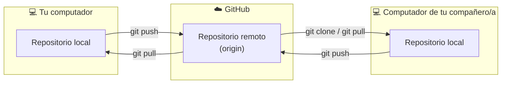

# Módulo 3 — GitHub y repositorios remotos

⏱️ 50 minutos · [⬅️ Anterior](02-ramas-merge-conflictos.md) · [Índice](../README.md) · [Siguiente ➡️](04-colaboracion-pull-requests.md)

## Objetivos

- Entender qué es un repositorio remoto.
- Autenticarte en GitHub desde la terminal.
- Publicar (`push`), descargar (`clone`) y sincronizar (`pull`, `fetch`) repositorios.

---

## 1. Local vs. remoto



- Un **remoto** es una copia del repositorio alojada en otro lugar (GitHub).
- Por convención, el remoto principal se llama **`origin`**.
- Git es **distribuido**: cada clon tiene el historial completo, no solo los archivos.

## 2. Autenticación

> ⚠️ Desde 2021, GitHub **no acepta tu contraseña** para operaciones Git por terminal. Usa una de estas opciones:

### Opción A — Git Credential Manager (recomendada en Windows)

Viene incluido con Git for Windows. La primera vez que hagas `push`, se abrirá el navegador para iniciar sesión en GitHub. Listo.

### Opción B — GitHub CLI (`gh`), cualquier sistema

```bash
# Instala desde https://cli.github.com
gh auth login
# Elige: GitHub.com → HTTPS → Login with a web browser
```

### Opción C — Llave SSH (recomendada en Linux/macOS)

```bash
ssh-keygen -t ed25519 -C "tu-correo@ejemplo.com"   # Enter en todo
cat ~/.ssh/id_ed25519.pub                          # copia el resultado
```

Pega la llave en **GitHub → Settings → SSH and GPG keys → New SSH key**. Prueba:

```bash
ssh -T git@github.com
# Hi <usuario>! You've successfully authenticated...
```

Con SSH, usa URLs del tipo `git@github.com:usuario/repo.git` en vez de `https://...`.

## 3. Publicar un repositorio local en GitHub

1. En GitHub: **New repository** → nombre `biblioteca-poo` → **sin** README ni `.gitignore` (ya los tienes localmente) → *Create repository*.
2. En tu terminal, dentro del proyecto:

```bash
git remote add origin https://github.com/<usuario>/biblioteca-poo.git
git remote -v                 # verifica
git push -u origin main       # -u enlaza tu main local con origin/main
```

Desde ahora basta con:

```bash
git push
```

## 4. Clonar un repositorio existente

```bash
git clone https://github.com/<usuario>/biblioteca-poo.git
cd biblioteca-poo
```

`clone` descarga todo el historial y configura `origin` automáticamente.

## 5. Mantenerse sincronizado

| Comando | Qué hace |
|---------|----------|
| `git fetch` | Descarga cambios del remoto **sin** tocar tus archivos. Puedes revisarlos con `git log origin/main` |
| `git pull` | `fetch` + `merge`: descarga **y** fusiona en tu rama actual |
| `git push` | Sube tus commits al remoto |

Flujo diario recomendado:

```bash
git pull               # 1. Antes de empezar: trae lo último
# ... trabajas, haces commits ...
git pull               # 2. Antes de subir: integra lo que otros hayan subido
git push               # 3. Sube tu trabajo
```

### El error más común

```
! [rejected]        main -> main (fetch first)
error: failed to push some refs to 'github.com:usuario/biblioteca-poo.git'
hint: Updates were rejected because the remote contains work that you do not have locally.
```

**Traducción:** alguien (¡o tú desde otro PC!) subió commits que tú no tienes. **Solución:** `git pull`, resuelve conflictos si aparecen, y vuelve a `git push`.

> ⚠️ **Nunca** uses `git push --force` en `main` de un repositorio compartido para “arreglar” esto: borrarías el trabajo de tus compañeros.

## 6. Ramas remotas

```bash
git push -u origin feature/prestamo   # sube una rama nueva
git branch -a                         # lista ramas locales y remotas
git switch feature/prestamo           # si existe solo en origin, Git crea la local automáticamente
git push origin --delete feature/prestamo   # elimina la rama en GitHub
```

## 7. README.md: la portada de tu proyecto

GitHub muestra el `README.md` en la página principal del repositorio. Un buen README para un proyecto de POO incluye:

```markdown
# Biblioteca POO

Sistema de gestión de préstamos de una biblioteca, desarrollado en Java para DSY1102.

## Diagrama de clases
(imagen o diagrama Mermaid)

## Cómo ejecutar
1. Abrir el proyecto en IntelliJ IDEA.
2. Ejecutar `Main.java`.

## Integrantes
- Nombre Apellido — @usuario
```

## Resumen de comandos

| Comando | Para qué |
|---------|----------|
| `git remote add origin <url>` | Conectar un repo local a GitHub |
| `git remote -v` | Ver remotos configurados |
| `git push -u origin <rama>` | Primera subida de una rama |
| `git push` / `git pull` | Subir / traer cambios |
| `git fetch` | Descargar sin fusionar |
| `git clone <url>` | Copiar un repo remoto |

## ✅ Checkpoint

1. ¿Qué diferencia hay entre `git fetch` y `git pull`?
2. `git push` te da error *rejected (fetch first)*. ¿Qué haces?
3. ¿Por qué no debes usar tu contraseña de GitHub en la terminal?

<details>
<summary>Ver respuestas</summary>

1. `fetch` solo descarga; `pull` descarga y además fusiona en tu rama actual.
2. `git pull`, resolver conflictos si los hay, y `git push` nuevamente.
3. GitHub ya no la acepta para Git: se usa Credential Manager, `gh`, un token o SSH.

</details>
