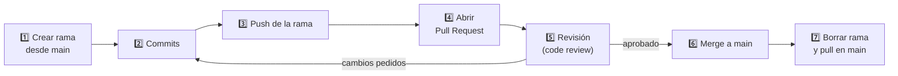

# Módulo 4 — Colaboración con Pull Requests

⏱️ 60 minutos · [⬅️ Anterior](03-github-remotos.md) · [Índice](../README.md) · [Siguiente ➡️](05-git-en-intellij.md)

## Objetivos

- Trabajar en equipo sobre un mismo repositorio usando **GitHub Flow**.
- Crear, revisar y fusionar **Pull Requests (PR)**.
- Organizar el trabajo con **Issues**.
- Entender la diferencia entre colaborar con *collaborators* y con *forks*.

---

## 1. Dos formas de colaborar

| Modelo | Cuándo se usa | Cómo funciona |
|--------|---------------|---------------|
| **Colaboradores** | Equipo pequeño que confía entre sí (¡tu grupo de POO!) | Todos tienen permiso de `push` al mismo repo; cada uno trabaja en ramas |
| **Fork** | Proyectos open source, o cuando no tienes permisos | Haces una copia del repo en tu cuenta, trabajas ahí y propones cambios vía PR |

Para los trabajos grupales de DSY1102 usaremos **colaboradores**:
*Repositorio → Settings → Collaborators → Add people*.

## 2. GitHub Flow

Un flujo simple y usado en la industria:



En comandos:

```bash
git switch main
git pull                                  # parte desde lo último
git switch -c feature/clase-prestamo      # 1
# ... programas Prestamo.java ...
git add src/Prestamo.java
git commit -m "Agrega clase Prestamo"     # 2
git push -u origin feature/clase-prestamo # 3
# 4-6 en GitHub
git switch main                           # 7
git pull
git branch -d feature/clase-prestamo
```

## 3. ¿Qué es un Pull Request?

Un PR es una **solicitud para fusionar** tu rama en `main`, con un espacio para **discutir y revisar** el código antes de que entre.

### Crear un PR

1. Tras hacer `push`, GitHub muestra un botón amarillo **“Compare & pull request”**.
2. Verifica: **base: `main`** ← **compare: `feature/clase-prestamo`**.
3. Escribe un buen título y descripción:

```markdown
## ¿Qué hace este PR?
Agrega la clase `Prestamo` que relaciona un `Libro` con un `Socio`.

## Cambios
- Nueva clase `Prestamo` con fecha de inicio y devolución.
- Método `estaAtrasado()` que compara con la fecha actual.

## ¿Cómo probarlo?
Ejecutar `Main.java`: se crea un préstamo de ejemplo y se imprime su estado.

Cierra #3
```

4. En el panel derecho: asigna **Reviewers** (tus compañeros), **Assignees** (tú) y **Labels**.
5. *Create pull request*.

> 💡 Escribir `Cierra #3` (o `Closes #3`) en la descripción cierra automáticamente el issue #3 cuando el PR se fusiona.

## 4. Revisar código (code review)

Revisar el código de otro es una habilidad profesional clave. En la pestaña **Files changed** del PR:

- Haz clic en el `+` junto a una línea para **comentar**.
- Al terminar, *Review changes* →
  - **Comment**: comentario general.
  - **Approve**: todo bien ✅.
  - **Request changes**: hay algo que corregir antes de fusionar.

### Qué revisar en un proyecto de POO

- [ ] ¿Los atributos son `private` y se accede vía getters/setters (encapsulamiento)?
- [ ] ¿Los nombres siguen las convenciones de Java (`PascalCase` para clases, `camelCase` para métodos)?
- [ ] ¿Se respetan las relaciones del diagrama de clases (herencia, composición)?
- [ ] ¿Hay código duplicado que podría ir en una superclase?
- [ ] ¿Compila? ¿Se probó?

### Cómo comentar con respeto

| ❌ Evita | ✅ Prefiere |
|---------|-------------|
| “Esto está mal.” | “¿Qué pasa si `socio` es `null` aquí? Quizás convenga validarlo.” |
| “No sabes usar herencia.” | “`Revista` y `Libro` comparten `titulo` y `anio`; ¿y si creamos una clase abstracta `Material`?” |

Para atender los comentarios, el autor hace **nuevos commits en la misma rama** y `git push`: el PR se actualiza solo.

## 5. Fusionar el PR

Cuando esté aprobado, botón **Merge pull request**. GitHub ofrece tres opciones:

| Opción | Resultado |
|--------|-----------|
| **Create a merge commit** | Conserva todos los commits + un commit de merge (por defecto) |
| **Squash and merge** | Junta todos los commits del PR en uno solo — historial de `main` más limpio |
| **Rebase and merge** | Reaplica los commits sobre `main` sin commit de merge |

Para el curso, **Squash and merge** o **merge commit** están bien. Luego, **Delete branch**.

Después, todos los integrantes actualizan su `main`:

```bash
git switch main
git pull
```

## 6. Proteger la rama `main`

Para que nadie suba directo a `main` sin revisión:
*Settings → Branches → Add branch ruleset* (o *Add classic branch protection rule*) → rama `main` →

- ✅ Require a pull request before merging
- ✅ Require approvals: 1

> ℹ️ En repositorios privados de cuentas gratuitas algunas reglas pueden no estar disponibles; en repos públicos sí.

## 7. Issues: organizar el trabajo

Un **Issue** es una tarea, bug o idea. Úsalos para repartir el trabajo del equipo:

| # | Issue | Asignado | Label |
|---|-------|----------|-------|
| #1 | Crear clase abstracta `Material` | @ana | `enhancement` |
| #2 | Crear clases `Libro` y `Revista` que hereden de `Material` | @benja | `enhancement` |
| #3 | Crear clase `Prestamo` | @cami | `enhancement` |
| #4 | `buscarPorTitulo` lanza NullPointerException | @ana | `bug` |

💡 La pestaña **Projects** permite armar un tablero Kanban (*To do / In progress / Done*) con estos issues.

## 8. Contribuir vía fork (open source)

```bash
# 1. En GitHub: botón "Fork" en el repo original
git clone https://github.com/<tu-usuario>/<repo>.git
cd <repo>
git remote add upstream https://github.com/<dueño-original>/<repo>.git
git switch -c fix/typo-readme
# ... cambios + commit ...
git push -u origin fix/typo-readme
# 2. En GitHub: abrir PR desde tu fork hacia el repo original
# 3. Mantener tu fork al día:
git fetch upstream
git switch main
git merge upstream/main
```

## ✅ Checkpoint

1. Ordena los pasos de GitHub Flow: *merge, crear rama, push, PR, commits, review*.
2. Tu compañero pidió cambios en tu PR. ¿Debes abrir un PR nuevo?
3. ¿Qué escribirías en la descripción de un PR para que cierre el issue #7 al fusionarse?

<details>
<summary>Ver respuestas</summary>

1. Crear rama → commits → push → PR → review → merge.
2. No: haces commits en la misma rama y `git push`; el PR se actualiza solo.
3. `Closes #7` (o `Fixes #7` / `Resolves #7`).

</details>
