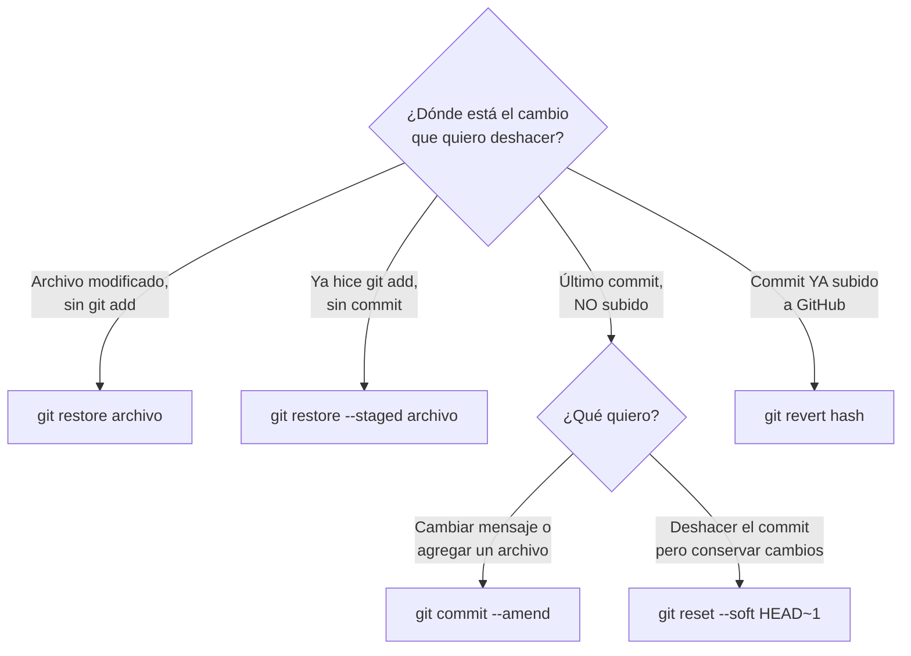
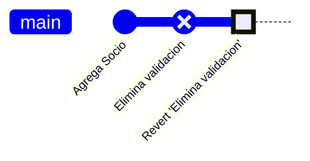

# Módulo 6 — Deshacer cambios y buenas prácticas

⏱️ 45 minutos · [⬅️ Anterior](05-git-en-intellij.md) · [Índice](../README.md)

## Objetivos

- Elegir el comando correcto para deshacer según la situación.
- Guardar trabajo temporalmente con `stash`.
- Escribir buenos mensajes de commit.
- Recuperar commits “perdidos” con `reflog`.

---

## 1. ¿Qué quiero deshacer? — Guía rápida



## 2. Antes del commit

### Descartar cambios en un archivo

```bash
git restore src/Libro.java
```

⚠️ **Irreversible** para Git: los cambios no guardados en un commit se pierden (IntelliJ *Local History* podría salvarte).

### Sacar un archivo del staging (sin perder los cambios)

```bash
git restore --staged src/Libro.java
```

## 3. Corregir el último commit (no subido)

```bash
# Olvidé agregar un archivo o me equivoqué en el mensaje
git add src/Socio.java
git commit --amend -m "Agrega clases Libro y Socio"
```

`--amend` **reemplaza** el último commit por uno nuevo. Úsalo solo si **no has hecho push**.

## 4. `git reset`: mover la rama hacia atrás (solo local)

| Comando | El commit… | Los cambios quedan… |
|---------|------------|---------------------|
| `git reset --soft HEAD~1` | se deshace | en **staging** |
| `git reset HEAD~1` (`--mixed`, por defecto) | se deshace | en el **working directory** |
| `git reset --hard HEAD~1` | se deshace | ❌ **se pierden** |

`HEAD~1` = “un commit antes de donde estoy”. `HEAD~3` = tres commits antes.

> ⚠️ **Nunca** hagas `reset` sobre commits que ya subiste a una rama compartida: reescribe el historial y tus compañeros tendrán problemas.

## 5. `git revert`: deshacer un commit ya publicado

`revert` **no borra** el commit: crea uno **nuevo** que aplica el cambio inverso. Es seguro en ramas compartidas.

```bash
git log --oneline
# 7c1e2aa Elimina validacion de RUT   <-- este rompió todo
git revert 7c1e2aa
git push
```



## 6. `git stash`: guardar trabajo a medias

Estás programando `Prestamo.java` y te piden corregir un bug urgente en `main`. Tu código no compila todavía, así que no quieres hacer commit.

```bash
git stash push -m "prestamo a medias"   # guarda y limpia el working directory
git switch main
# ... corriges el bug, commit, push ...
git switch feature/prestamo
git stash pop                           # recupera tus cambios
```

| Comando | Para qué |
|---------|----------|
| `git stash list` | Ver stashes guardados |
| `git stash pop` | Aplicar el último y eliminarlo de la lista |
| `git stash apply` | Aplicar sin eliminarlo |
| `git stash drop` | Eliminar el último sin aplicarlo |
| `git stash -u` | Incluir también archivos nuevos (untracked) |

## 7. `git reflog`: la máquina del tiempo

¿Hiciste `reset --hard` y perdiste commits? Git guarda un registro de todos los lugares donde ha estado `HEAD` (por defecto, alrededor de 90 días):

```bash
git reflog
# 4b2d9f1 HEAD@{0}: reset: moving to HEAD~1
# 9e8a7c3 HEAD@{1}: commit: Agrega metodo devolver()   <-- ¡aquí estaba!
git reset --hard 9e8a7c3     # vuelves a ese punto
```

> 💡 Mientras un commit haya existido en tu repositorio local, casi siempre se puede recuperar con `reflog`.

## 8. Buenas prácticas

### Mensajes de commit

Formato recomendado:

```
<Verbo en imperativo> <qué cambió> (máx. ~50 caracteres)

(Opcional, tras una línea en blanco) Por qué se hizo el cambio,
qué problema resuelve. Líneas de ~72 caracteres.
```

| ❌ Malo | ✅ Bueno |
|---------|----------|
| `cambios` | `Agrega clase abstracta Material` |
| `fix` | `Corrige calculo de multa por dias de atraso` |
| `avance proyecto` | `Implementa interfaz Prestable en Libro y Revista` |
| `.` | `Renombra metodo get_titulo a getTitulo` |

> 💡 Algunos equipos usan **Conventional Commits** (`feat:`, `fix:`, `docs:`, `refactor:`), por ejemplo `feat: agrega clase Prestamo`. Es opcional en este curso, pero muy común en la industria.

### Los 10 mandamientos de Git para DSY1102

1. `git status` antes y después de todo.
2. Un commit = un cambio lógico.
3. `main` siempre compila.
4. Todo trabajo nuevo va en una rama.
5. `git pull` antes de empezar y antes de hacer `push`.
6. Nunca subas `.class`, `out/`, `target/` ni contraseñas: usa `.gitignore`.
7. Nunca `push --force` sobre `main`.
8. Revierte (`revert`) lo publicado; resetea (`reset`) solo lo local.
9. Escribe mensajes que tu yo del futuro entienda.
10. Haz commit y push **seguido**: el commit que no hiciste es el que vas a lamentar.

## ⚠️ Seguridad: subí una contraseña por error

Borrar el archivo en un commit nuevo **no basta**: la contraseña sigue en el historial.

1. **Cambia la contraseña / revoca el token inmediatamente.** Es lo más importante.
2. Agrega el archivo a `.gitignore`.
3. Si el repo es público, considera limpiar el historial (herramientas como `git filter-repo`) — pide ayuda a tu docente.

## ✅ Checkpoint

Indica el comando para cada situación:

1. Hice `git add` de `Main.java` por error.
2. Mi último commit (sin push) tiene un error de ortografía en el mensaje.
3. Un commit de hace 3 días, ya en GitHub, introdujo un bug.
4. Necesito cambiar de rama pero tengo cambios que no compilan.

<details>
<summary>Ver respuestas</summary>

1. `git restore --staged Main.java`
2. `git commit --amend -m "Mensaje corregido"`
3. `git revert <hash>` y `git push`
4. `git stash push -m "descripcion"` (y luego `git stash pop`)

</details>

---

🎉 **¡Terminaste los módulos!** Ahora ve a los [laboratorios](../README.md#laboratorios-prácticos).
